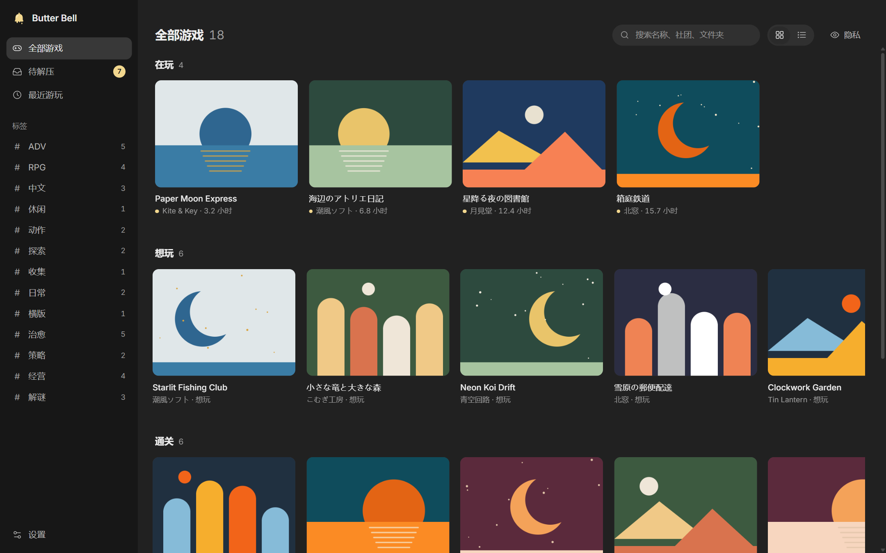
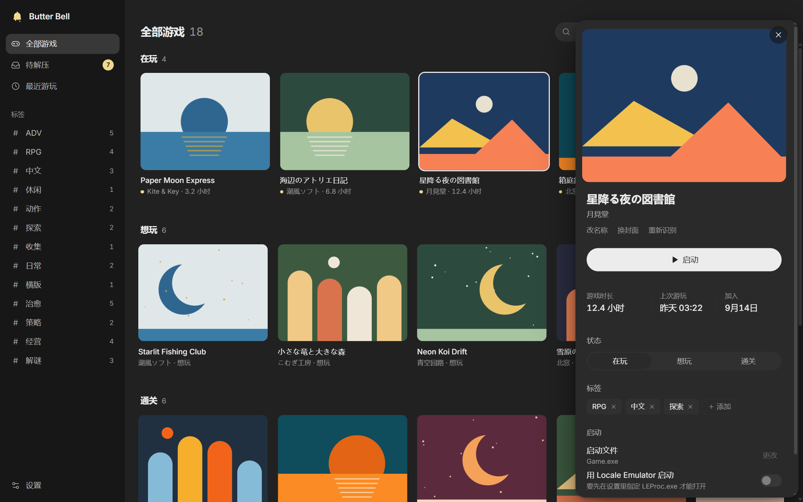
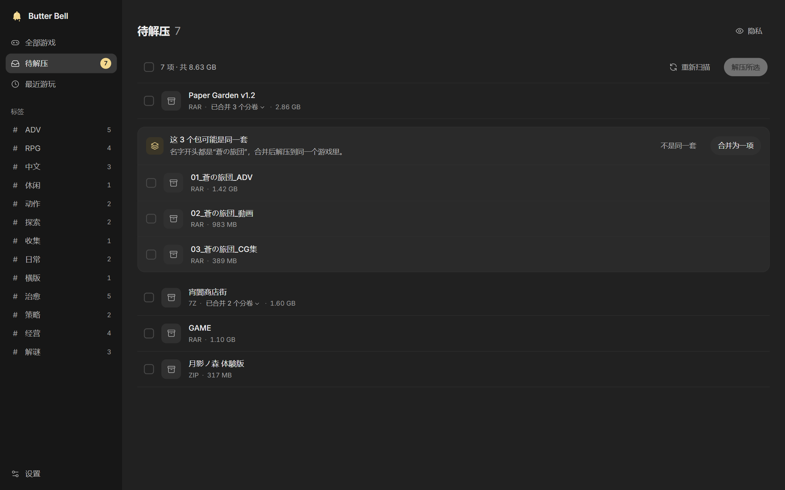
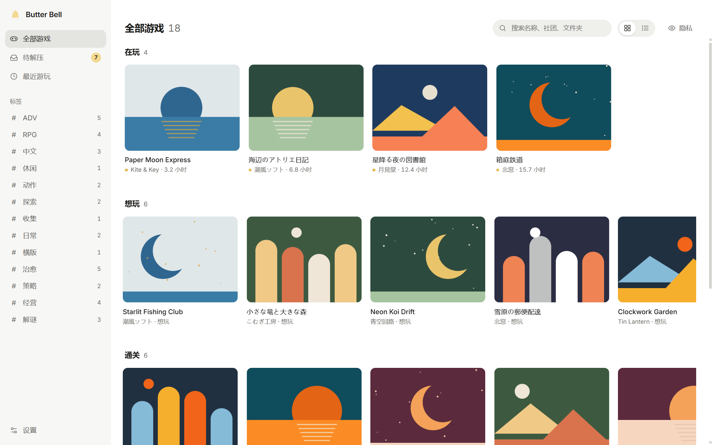

# Butter Bell

一个 Windows 本地游戏库管理器。把你手动下载的游戏压缩包解压、整理成游戏库，用封面墙浏览，从库里直接启动，并记录游玩时长。

> **English**: Butter Bell is a local game library manager for Windows. It extracts the game archives you have downloaded (multi-volume archives and password lists supported), organizes them into a cover-wall library with tags and play status, launches games and tracks playtime. Everything stays on your computer. The interface is currently Chinese only; translations are welcome. Download it from the [Releases](../../releases/latest) page.



截图里的游戏名、社团和封面都是虚构的示例。

## 功能

- **待解压收件箱**：选好放压缩包的“仓库目录”，新下载的包自己出现在这里。分卷（`.part1.rar`、`.7z.001` 等）自动合并成一项，名字前缀相同的几个包会提示“可能是同一套”，由你决定要不要合并。勾选后批量解压，自带 7-Zip，支持 rar / 7z / zip / zst。
- **解压密码**：可以给单个压缩包记住密码，也可以维护一张常用密码表，解压时自动逐个尝试。密码用 Windows 的加密功能保存在本机，不存明文。
- **现成的游戏文件夹**：游戏目录里已经有的文件夹，不用压缩包也能直接加入游戏库。
- **补资料**：可以去 DLsite 按名称搜索，列出候选由你亲自选定，程序从不替你自动选；搜不到就手动填名称、选封面。
- **游戏库**：封面墙和列表两种视图，按“在玩 / 想玩 / 通关”分排；自由标签、搜索；详情页里启动、改启动文件、改名、换封面。
- **启动和计时**：从库里启动游戏，自动记录游玩时长和上次游玩时间。纯 HTML 游戏用默认浏览器打开。
- **卸载和接回**：卸载时游戏文件夹进回收站，名称、封面、时长、标签都保留；以后重新解压同一个包，记录会自动接回。
- **Locale Emulator**：可以按游戏单独打开“用 LE 启动”，日文游戏乱码时用得上。
- **隐私模式**：一键（或 `Ctrl+Shift+H`）模糊所有封面。
- **亮色 / 暗色**跟随系统，也可以手动指定。
- **检查更新**：启动时问一次 GitHub 有没有新版本，有就在侧栏提示，只提示、不自动下载，设置里可以关掉。

程序只读取你选的两个文件夹里的文件名，不会改名或搬动你的游戏文件。只有解压后你选了“移到回收站”或“挪进已解压文件夹”，才会处理压缩包本身。

| | |
|---|---|
|  |  |
|  | |

## 安装

只支持 Windows 10 / 11（64 位）。到 [Releases](../../releases/latest) 页面下载，两种任选一种：

- **安装版**（`Butter Bell-<版本>-setup.exe`）：装到当前用户，不需要管理员权限。数据（游戏库、封面）存在 `%APPDATA%\Butter Bell`。卸载在 Windows 的“设置 → 应用”里；卸载只删程序本身，游戏库数据会保留，想彻底清掉就手动删除那个文件夹。
- **绿色版**（`Butter Bell-<版本>-portable.exe`）：不用安装，双击就能用。数据存在 exe 旁边的 `Butter Bell Data` 文件夹里，整个文件夹拷走就能带着游戏库走。注意：保存的解压密码是用这台电脑的 Windows 账户加密的，换了电脑要重新输入。

第一次打开时会让你选两个文件夹：放压缩包的**仓库目录**和放游戏的**游戏目录**，以后都能在设置里改。

程序没有代码签名，第一次运行时 Windows 可能弹出“Windows 已保护你的电脑”，点“更多信息”→“仍要运行”即可。

### Locale Emulator 需要自己安装

程序**不自带** [Locale Emulator](https://github.com/xupefei/Locale-Emulator)。需要的话先自己下载安装，再在设置里指定 `LEProc.exe` 的位置，游戏详情里的“用 LE 启动”开关才能打开。

## 联网

程序只在这两种情况下联网：

- 你在补资料时搜索 DLsite（以及下载你选定的封面）。
- 启动时检查更新：只向 GitHub 请求最新的版本号，不上传任何库里的信息。可以在设置里关掉。

## 开发

需要 Node.js 22 或更新版本。

```bash
npm install
npm run dev     # 启动开发版
npm test        # 跑测试
npm run build   # 打包安装版和绿色版到 dist/
```

- 开发时设环境变量 `BUTTER_BELL_DATA=<文件夹>` 可以用另一份数据目录，不碰平时的库。
- `npx electron scripts/make-demo.cjs <新文件夹>` 生成一份演示数据（虚构游戏 + 代码画的封面），README 截图就是用它截的。
- 检查更新用的仓库地址写在 `package.json` 的 `repository` 里，没写就不检查。
- 界面文字在 `src/renderer/src/locales/`，欢迎帮忙翻译。

## 许可证

[MIT](LICENSE)

### 第三方组件

程序自带 [7-Zip](https://www.7-zip.org/) 26.05 的 `7z.exe` 和 `7z.dll` 用来解压，作者 Igor Pavlov。7-Zip 采用 GNU LGPL 许可，其中的 RAR 解压代码另有 unRAR 许可限制（不得用于重新制作 RAR 压缩器）。许可证全文见 [resources/7zip/License.txt](resources/7zip/License.txt)，来源和校验值见 [resources/7zip/README.md](resources/7zip/README.md)。

界面字体 [Inter](https://rsms.me/inter/) 采用 SIL Open Font License 1.1。其余依赖（Electron、React、better-sqlite3 等）的许可证见各自的 npm 包。
